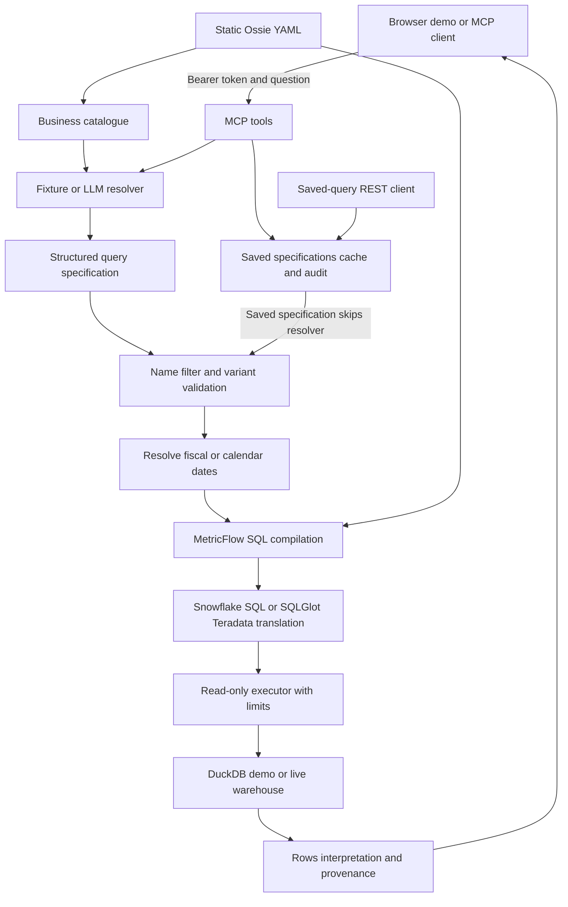

# MCP run guide architecture and implementation

This guide describes the current implementation and how to run it independently
or inside the tuning-fork FastAPI backend. Start with the isolated browser demo:
it needs no LLM credentials and avoids importing the host's Azure configuration.

The demo uses predefined question interpretations, MetricFlow compilation and
actual SQL execution on synthetic DuckDB data. It is not a live warehouse or
natural-language accuracy demonstration.

## 1. Quick start on Windows

### Standalone real LLM test without tuning-fork

Clone pkapde/server on the test system and use its main branch. Install the
requirements and prepare data/tokenizer using the commands below. Copy
.env.llm.example to .env and set MCP_LLM_BASE_URL, MCP_LLM_API_KEY and
MCP_LLM_MODEL to your approved compatible provider. Do not share the key.

```powershell
Copy-Item .env.llm.example .env
# Edit .env locally before starting.
python -m uvicorn main_mcp_llm:create_app --factory --host 127.0.0.1 --port 8000
```

Open http://127.0.0.1:8000/, enter local-demo-token and connect. The page says
Live LLM interpretation. Type a new question about the sample metrics and check
resolver_mode=llm and llm_calls=1 on an uncached successful interpretation.
Repeated cached questions and saved runs show zero LLM calls. No warehouse
credentials, tuning-fork source, host Azure settings or public HTTPS deployment
are needed. The local server can use HTTP while its outbound provider URL uses
HTTPS. A provider-specific API adapter may still be required.

main_mcp_llm deliberately forces LLM interpretation and DuckDB execution. It
reads .env with MCP_ prefixes. main_mcp_demo continues to force fixture mode.
The real-provider connection cannot be verified until credentials are supplied;
automated tests use a simulated compatible provider, not a real LLM.

Run every command from the repository root, beside main_mcp_demo.py.
Use the same Python environment for installation, the server and the client.
Local verification used Python 3.12. The organisation Dockerfile uses Python
3.11; verify combined dependencies there. Declared package support is Python
3.11 through 3.14, but that does not establish testing on every version.

If Python 3.11 is installed through your organisation's approved process:

```powershell
py -3.11 -m venv .venv
.\.venv\Scripts\Activate.ps1
python --version
```

For this standalone repository:

```powershell
python -m pip install -r requirements-mcp.txt
python -m pip check
```

For the tuning-fork backend, resolve its existing requirements together with MCP:

```powershell
python -m pip install --dry-run -r requirements.txt -r requirements-mcp.txt
python -m pip install -r requirements.txt -r requirements-mcp.txt
python -m pip check
```

Prepare the local data and tokenizer, then start the demo:

```powershell
python scripts/prepare_tokenizer.py
python scripts/seed_demo.py
python -m uvicorn main_mcp_demo:app --host 127.0.0.1 --port 8000
```

The tokenizer preparation can download vocabulary on its first run. Seed only
the local synthetic database: seed_demo.py deletes and recreates its sample rows.
Run it before starting the server, not while queries are using the file.

## 2. Test through the browser

1. Open http://127.0.0.1:8000/.
2. Enter local-demo-token in the bearer-token field.
3. Select Connect and discover tools. It should list ask_question and save_query.
4. Choose a sample question and select Ask question.
5. Inspect the result table, interpretation, provenance and full response.
6. Enter a query name and select Save answered question.
7. Select Run saved query. Inspect llm_calls in provenance; it should be zero.

For the question "What is hold percentage by channel last fiscal month?", when
the previous fiscal period is the sample September period, expected results are:

| Channel | Returned fraction | Meaning |
| --- | --- | --- |
| Call | 0.25 | 25 percent |
| Chat | 0.10 | 10 percent |
| Email | null | Zero denominator |

Additional useful sample questions:

- "How many total interactions by channel?" returns Call 4, Chat 3, Email 1.
- "What is the resolution rate?" returns ambiguity because no variant default exists.
- "What is the one day resolution rate by channel?" selects the explicit variant.
- "How many total interactions for Fax?" rejects the unsupported filter value.

Fixture mode supports the exact questions in examples/questions.json, with the
implemented whitespace normalization. It does not interpret arbitrary paraphrases.
Sample fiscal periods cover July 27 through December 27, 2026. Relative fiscal
questions outside calendar coverage fail; use an all-time sample or extend the model.

The page does not persist bearer tokens. Its JavaScript uses MCP JSON-RPC for
initialize, notifications/initialized, tools/list and tools/call. Saved reruns
use the REST API. Analytical endpoints remain authenticated even though the
local demo page and health check are public.

## 3. Test through the Python MCP client

Keep the server running. In a second terminal, activate the same environment:

```powershell
.\.venv\Scripts\Activate.ps1
$env:SERVICE_URL = 'http://127.0.0.1:8000/analytics'
$env:SERVICE_TOKEN = 'local-demo-token'
python scripts/demo_client.py
```

This client uses the official MCP SDK. It discovers tools, asks a sample question,
saves the resolution, and reruns the saved query over REST with zero LLM calls.

## 4. Endpoints and entry points

| Entry point | Purpose | Base path |
| --- | --- | --- |
| main_mcp_demo:app | Isolated fixture demo with browser page | /analytics |
| main_mcp_llm:create_app --factory | Standalone real LLM with browser page and synthetic data | /analytics |
| Host main.py plus install_mcp(app) | MCP integrated into the full backend | /analytics |
| scripts/start.py | Standalone service without the browser page | No prefix |

For the isolated demo and integrated backend:

| Endpoint | Method | Purpose |
| --- | --- | --- |
| / | GET | Browser UI on main_mcp_demo only |
| /analytics/health | GET | Public mode/model health information |
| /analytics/mcp | POST | Authenticated MCP protocol |
| /analytics/api/v1/saved-queries/{id} | GET | Retrieve caller-owned saved specification |
| /analytics/api/v1/saved-queries/{id}/run | POST | Execute a saved specification |
| /analytics/docs | GET | Authenticated REST documentation, not a chat page |

Opening /analytics/docs or /analytics/mcp in a browser without an Authorization
header returns unauthorized. Use the demo page for interactive testing.
The standalone scripts/start.py variant uses /mcp and /health instead; omit
/analytics from SERVICE_URL when testing that entry point.

## 5. Architecture



The semantic model defines calculations. The resolver selects governed objects;
it does not author SQL. In LLM mode the internal resolver receives only the
question and catalogue, never result rows. Authenticated consumer clients do
receive results and may themselves contain an LLM.

## 6. Question execution

1. Authenticate the bearer token and establish the caller identity.
2. Look up the normalized question in the specification cache. The cache key
   includes model hash and resolver configuration to avoid mixing interpretations.
3. On a cache miss, resolve the question using a fixture or approved LLM endpoint.
4. Validate exact model names, filter values and metric-variant choices.
5. Recalculate relative dates using the configured model calendar and timezone.
6. Select a single warehouse based on model bindings/preferences. No federation.
7. Compile the specification with MetricFlow and translate dialect if required.
8. Check generated SQL is an allowed single SELECT over model-approved bindings.
9. Execute with row, timeout and per-process concurrency controls.
10. Build results and provenance, retain a successful resolution for saving,
    and persist audit information. Audit failures do not return unaudited rows.

Repeated specifications produce stable SQL for the same model, resolved dates
and execution target. Relative periods change deliberately; warehouse results
can also change when underlying data changes.

## 7. Tools and saved-query behavior

| Tool | Input | Output |
| --- | --- | --- |
| ask_question | question string | answered, cannot_answer or error response |
| save_query | server-issued resolution_id and name | saved_query_id and interpretation |

The client cannot submit a modified specification to save_query. Successful
resolutions and saved queries are scoped to the caller identity.
Saved queries store the logical specification, interpretation, creator and model
hash, not result rows. On rerun the service skips the resolver, recalculates
relative dates and executes again. A changed model hash requires resolving again.

Response provenance includes metric owners, explicit/default choices, filters,
absolute time range, applicable caveats, model and SQL hashes, execution timestamp,
warehouse bindings, correlation identifier, modes and LLM call count. Decimal
driver values can be serialized as strings to preserve precision. Percentages
are fractions, not automatically multiplied by 100.

## 8. Implementation map

| File | Responsibility |
| --- | --- |
| main_mcp_demo.py | Independent local host, demo UI and fixture settings |
| semantic_mcp/demo_ui.py | Self-contained browser page with authenticated MCP requests |
| semantic_mcp/integration.py | Mount service and compose host/child lifespans |
| semantic_mcp/app.py | Official FastMCP tools, REST routes and ASGI authentication |
| semantic_mcp/config.py | Validated settings and production safeguards |
| semantic_mcp/contracts.py | Strict specification, resolver and response schemas |
| semantic_mcp/model.py | Static model loading, metadata and supported-construct validation |
| semantic_mcp/resolver.py | Catalogue, fixture lookup, LLM request and malformed-output retry |
| semantic_mcp/validator.py | Governed name, filter, scope and variant rules |
| semantic_mcp/time_ranges.py | Relative fiscal/calendar date resolution |
| semantic_mcp/compiler.py | Native MetricFlow planning, metadata and SQLGlot integration |
| semantic_mcp/warehouses.py | DuckDB, Snowflake and Teradata execution adapters |
| semantic_mcp/service.py | Query/save/rerun orchestration and provenance |
| semantic_mcp/store.py | SQLAlchemy persistence for cache, audit and saved definitions |
| examples/cx.ossie.yaml | Synthetic reference semantic model |
| examples/questions.json | Fixture interpretations and sample questions |
| scripts/seed_demo.py | Synthetic warehouse creation |
| scripts/prepare_tokenizer.py | Tokenizer cache preparation for offline startup |
| scripts/demo_client.py | Actual MCP SDK plus saved-query REST smoke test |
| scripts/package_integration.py | Source-only integration ZIP builder |

## 9. Integrate into tuning-fork

The current package is at repository root; do not move it into src without
updating imports and packaging. Copy:

```text
tuning-fork-be-main/
  main.py                         existing application
  main_mcp_demo.py                 isolated demo entry point
  requirements-mcp.txt             additional dependencies
  MCP_RUNBOOK.md                   this guide
  semantic_mcp/                    entire Python package, no __pycache__
  examples/
    cx.ossie.yaml
    questions.json
  scripts/
    prepare_tokenizer.py
    seed_demo.py
    demo_client.py
  src/                            existing backend remains here
```

Add the following import to the host main.py:

```python
from semantic_mcp.integration import install_mcp
```

At the end of its create_app(), after existing route and exception-handler
registration, place the call immediately before return app:

```python
    install_mcp(app)
    return app
```

Keep the existing lifespan and database initialization. The installer composes
that lifespan with the MCP session manager and cleanup. Do not install twice.
Register before any catch-all route. Host middleware still runs on mounted
requests; host route dependencies do not automatically secure MCP.

The host's own required settings must still be valid. If Azure settings are
constructed during host imports, fixture mode cannot disable them. Use
main_mcp_demo.py until the host is configured or its optional services are
made lazy by the backend team. Do not invent Azure credentials to pass validation.

Do not overwrite the organisation's main.py, requirements.txt, Dockerfile or .env.
Do not copy .venv, var, credentials or Git metadata. See INTEGRATION.md for
Docker COPY, tokenizer preparation, file permissions and dependency installation.

## 10. Configuration modes

The integrated installer reads MCP_-prefixed settings from .env and environment.
The standalone service reads the same field names without the prefix.

| Integrated setting | Purpose |
| --- | --- |
| MCP_MODEL_PATH | Semantic YAML location |
| MCP_DATABASE_URL | Application persistence, initially separate from host DB |
| MCP_DEMO_DATABASE_PATH | Synthetic DuckDB file |
| MCP_RESOLVER_MODE | fixture or llm |
| MCP_EXECUTION_MODE | demo or live |
| MCP_API_TOKENS | JSON token-to-caller map |
| MCP_ALLOWED_HOSTS / MCP_ALLOWED_ORIGINS | MCP transport host/origin allowlists |
| MCP_ROW_CAP | Maximum result rows, default 5000 |
| MCP_QUERY_TIMEOUT_SECONDS | Execution timeout, default 60 |
| MCP_MAX_CONCURRENCY | Active query limit per process, default 4 |

main_mcp_demo.py explicitly forces fixture/demo modes and its SQLite URL. It
does not read .env (_env_file=None), although other MCP_ environment variables
can still override settings not explicitly supplied. Therefore editing .env
cannot turn that demo entry point into a live resolver.

For live interpretation over sample data, use main_mcp_llm:create_app --factory
or the normal integrated host, then set:

```dotenv
MCP_RESOLVER_MODE=llm
MCP_EXECUTION_MODE=demo
MCP_LLM_BASE_URL=https://your-approved-endpoint/v1
MCP_LLM_API_KEY=your-approved-secret
MCP_LLM_MODEL=your-model
```

The current resolver requires /chat/completions and strict JSON-schema output.
Direct Anthropic and differently shaped Azure endpoints require an adapter.
The full catalogue is sent on an uncached resolution, with temperature zero.
Malformed output gets one retry; this is not an LLM SQL-repair loop.

Live warehouse execution uses MCP_EXECUTION_MODE=live and MCP_SNOWFLAKE_* or
MCP_TERADATA_* settings from config.py. Accounts require SELECT-only grants.
Production validation additionally requires a live LLM, live execution,
PostgreSQL, non-demo tokens and an HTTPS LLM endpoint. TLS termination, secret
injection, warehouse access and infrastructure deployment remain environment work.

## 11. Model semantics and scope

- Static Ossie 0.1.1 model loaded at startup; not arbitrary YAML or every Ossie construct.
- Simple supported aggregates and ratios; unsupported expressions are rejected.
- Non-additive ratios are recomputed at the output grain.
- Supported semi-additive snapshots use MetricFlow snapshot semantics.
- Compiler metadata supplies valid dimensions; tested join paths reject fan-out.
- Intrinsic filters cannot be removed by a question.
- An explicit variant is respected; a declared default is disclosed.
- Missing defaults and unresolved ambiguity produce cannot_answer with candidates.
- Aggregated analysis only: no detail-list tool, SQL submission tool or warehouse writes.
- Model changes require restart; saved-query migration across model versions is not implemented.

Upstream extraction, clustering, reviewer decisions and registry governance are
outside this service. The upstream team must supply an approved, supported model.

## 12. Troubleshooting

| Symptom | Action |
| --- | --- |
| No module named mcp | Install requirements-mcp.txt with the same Python used for uvicorn |
| Azure Settings validation failure | Use main_mcp_demo:app rather than importing host main.py |
| / returns Not Found | Confirm you started main_mcp_demo:app, not the standalone service |
| Browser docs or MCP returns unauthorized | Expected without bearer headers; use the root demo page |
| Demo says unauthorized | Enter the configured token; default is local-demo-token |
| Unknown question returns cannot_answer | Select an exact sample question in fixture mode |
| Demo warehouse missing | Run seed_demo.py from the repository root before startup |
| Model or fixture file missing | Preserve examples/ layout and run from repository root |
| Port already in use | Stop the old server or choose another port and update SERVICE_URL |
| Relative period unavailable | Check sample calendar coverage and actual current date |
| Dependency conflict | Resolve combined host/MCP constraints in the target runtime; do not force --no-deps |
| Proxy origin/host rejected | Configure the actual trusted MCP_ALLOWED_HOSTS and MCP_ALLOWED_ORIGINS |

## 13. Verification and remaining work

For development dependencies in this repository:

```powershell
python -m pip install -e '.[dev]'
python -m pytest -q
python -m ruff check semantic_mcp scripts tests main_mcp_demo.py
```

The local foundation passed 38 tests before the UI addition. Four focused
UI/integration tests passed after it, and a real browser verified discovery,
ask, save and REST rerun with expected sample results. These checks ran on
Python 3.12. They do not establish production or organisation integration acceptance.

Still required: target Python 3.11 and combined host dependency verification,
full host startup, approved LLM accuracy testing, enterprise model compatibility,
actual Teradata/Snowflake execution, trusted-report reconciliation, external
agent client testing and deployment verification.
